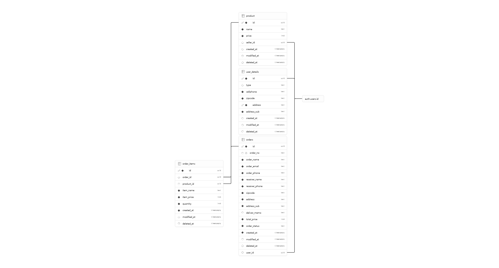
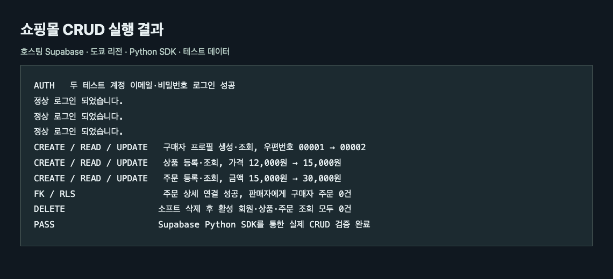

# Shopping Mall Backend

Supabase와 Python을 이용한 회원, 상품, 주문 CRUD 과제입니다.

## 구성

- `users.ipynb`: 회원 정보 CRUD
- `products.ipynb`: 상품 CRUD
- `orders.ipynb`: 주문 CRUD
- `supabase_schema.sql`: 테이블·PK/FK 및 RLS 정책
- `policy.sql`: 초기 주문 정책 실습 자료
- `supabase_client.py`: 공통 Supabase 클라이언트 생성

## 실행 준비

Python 가상환경을 만든 뒤 의존성을 설치합니다.

```bash
python3 -m venv .venv
source .venv/bin/activate
pip install -r requirements.txt
```

`.env.example`을 `.env`로 복사한 뒤 Supabase Dashboard의 Connect 화면에서
프로젝트 URL과 publishable key를 입력합니다.

```bash
cp .env.example .env
```

```dotenv
SUPABASE_URL=https://your-project-ref.supabase.co
SUPABASE_PUBLISHABLE_KEY=sb_publishable_your_key
```

`secret` 또는 `service_role` 키는 이 과제 저장소와 노트북에 입력하지 않습니다.

## 노트북에서 연결

각 노트북 앞부분의 다음 셀을 먼저 실행합니다.

```python
from supabase_client import get_supabase_client

supabase = get_supabase_client()
```

인증이 필요한 CRUD를 실행하기 전에는 자신의 테스트 계정으로 로그인합니다.
이메일과 비밀번호를 노트북에 저장하거나 GitHub에 올리지 않습니다.

```python
from getpass import getpass

email = input("Supabase 이메일: ")
password = getpass("Supabase 비밀번호: ")

supabase.auth.sign_in_with_password(
    {
        "email": email,
        "password": password,
    }
)
```

## 보안 주의사항

- `.env`는 Git에 포함하지 않습니다.
- RLS를 활성화하고 `anon` 및 `authenticated` 역할의 정책을 확인합니다.
- 실행 결과에 이메일, 전화번호, 주소가 포함되면 GitHub 공유 전에 지웁니다.

## 테이블 PK·FK



## 호스팅 Supabase CRUD 동작 캡처

무료 프로젝트 `kant-shopping-db`(도쿄)에 [테이블과 RLS 스키마](./supabase_schema.sql)를 적용했습니다. 구매자와 판매자 테스트 계정으로 로그인한 뒤, Python 노트북에 정의된 함수를 실행해 회원 정보·상품·주문의 생성, 조회, 수정, 소프트 삭제를 확인했습니다. 주문 상세의 FK 연결과 판매자가 구매자의 주문을 읽을 수 없는 것도 확인했습니다.



초기 [로컬 PostgreSQL 검증](./screenshots/crud-postgresql.png)과 [재실행용 SQL](./crud_verification.sql)도 참고할 수 있습니다.
