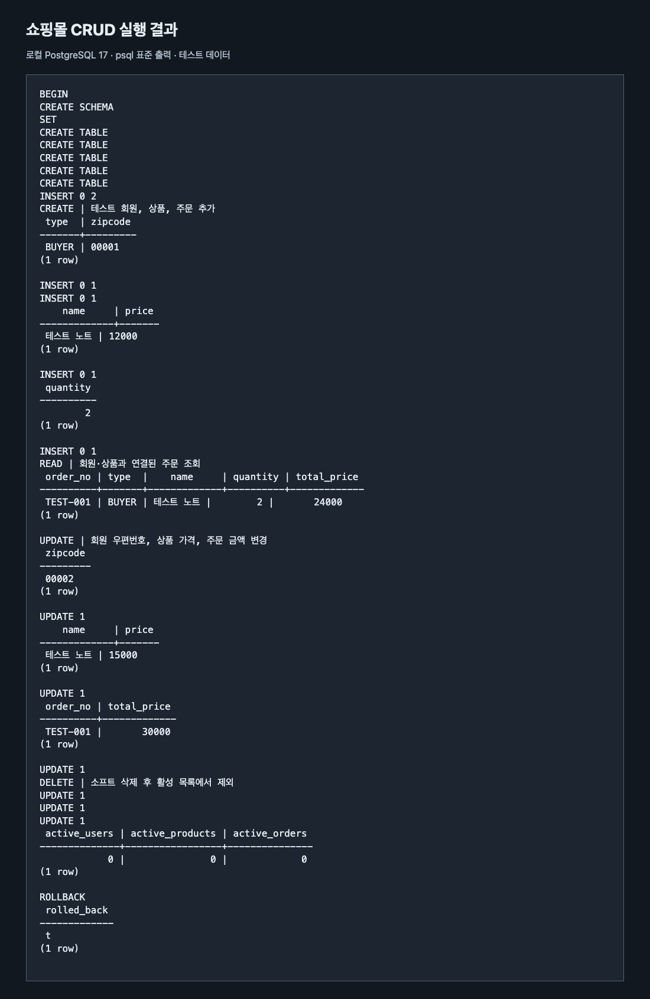

# Shopping Mall Backend

Supabase와 Python을 이용한 회원, 상품, 주문 CRUD 과제입니다.

## 구성

- `users.ipynb`: 회원 정보 CRUD
- `products.ipynb`: 상품 CRUD
- `orders.ipynb`: 주문 CRUD
- `policy.sql`: 주문 테이블 RLS 정책
- `supabase_client.py`: 공통 Supabase 클라이언트 생성

## 실행 준비

Python 가상환경을 만든 뒤 의존성을 설치합니다.

```bash
python3 -m venv .venv
source .venv/bin/activate
pip install -r requirements.txt
```

`.env.example`을 `.env`로 복사한 뒤 Supabase Dashboard의 Connect 화면에서
프로젝트 URL과 publishable key를 입력합니다.

```bash
cp .env.example .env
```

```dotenv
SUPABASE_URL=https://your-project-ref.supabase.co
SUPABASE_PUBLISHABLE_KEY=sb_publishable_your_key
```

`secret` 또는 `service_role` 키는 이 과제 저장소와 노트북에 입력하지 않습니다.

## 노트북에서 연결

각 노트북 앞부분의 다음 셀을 먼저 실행합니다.

```python
from supabase_client import get_supabase_client

supabase = get_supabase_client()
```

인증이 필요한 CRUD를 실행하기 전에는 자신의 테스트 계정으로 로그인합니다.
이메일과 비밀번호를 노트북에 저장하거나 GitHub에 올리지 않습니다.

```python
from getpass import getpass

email = input("Supabase 이메일: ")
password = getpass("Supabase 비밀번호: ")

supabase.auth.sign_in_with_password(
    {
        "email": email,
        "password": password,
    }
)
```

## 보안 주의사항

- `.env`는 Git에 포함하지 않습니다.
- RLS를 활성화하고 `anon` 및 `authenticated` 역할의 정책을 확인합니다.
- 실행 결과에 이메일, 전화번호, 주소가 포함되면 GitHub 공유 전에 지웁니다.

## 테이블 PK·FK


## CRUD 동작 캡처

관계도의 PK·FK 구조를 바탕으로 별도 **로컬 PostgreSQL 17** 테스트 스키마에서 회원·상품·주문의 CRUD를 실행했습니다. 회원과 상품을 주문 상세에 연결해 조회하고, 수정 후 주문 금액이 24,000원에서 30,000원으로 바뀌는 것을 확인했습니다. 소프트 삭제 후 활성 회원·상품·주문은 모두 0건이며, 검증 트랜잭션은 롤백했습니다.

아래는 실제 `psql` 실행 출력을 캡처한 화면입니다. 호스팅된 Supabase와 Python 노트북의 인증·API 호출은 이 검증 범위에 포함되지 않습니다.



[검증 SQL](./crud_verification.sql)은 테스트용 PostgreSQL DB에서 `psql -X -f crud_verification.sql`로 재실행할 수 있습니다.
